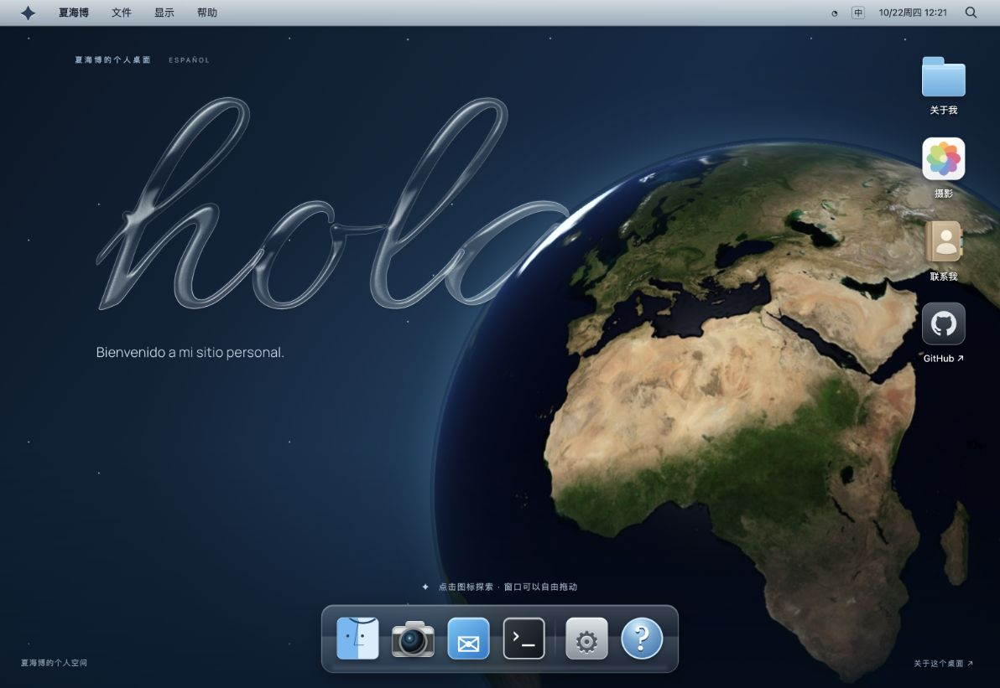

<div align="center">

# 夏海博 · 个人桌面

**把个人主页，做成一台可以探索的复古电脑。**

UNSW 大一机械工程 · 摄影 · 一个属于自己的桌面

[在线访问](https://haibo-desktop.duskytulip14.chatgpt.site) · [本地运行](#本地运行) · [部署到-github-pages](#部署到-github-pages)

</div>



> 当前在线版本由 ChatGPT Sites 托管，可能需要使用站点所有者的 ChatGPT 账号登录。通过下方步骤部署到 GitHub Pages 后，可使用自己的 Pages 地址展示。

## 关于这个主页

你好，我是夏海博，在 UNSW 读大一，学习机械工程，喜欢摄影。

这个网站以早期 macOS 的 Aqua 桌面为灵感，把自我介绍、摄影和联系方式放进可拖动的窗口。打开网页，先看到多语言手写欢迎字和缓慢旋转的地球，再通过桌面图标和 Dock 探索内容。

整个项目是纯静态网站，不需要安装 Node.js、运行构建命令或配置后端。

## 设计与功能

| 内容 | 体验 |
| --- | --- |
| 复古桌面 | 顶部菜单栏、立体 App 图标、玻璃 Dock 与窗口交通灯按钮 |
| 多语言欢迎 | 中文、英文、法文、西班牙文、意大利文、德文循环切换，配有手写字显现动画 |
| 玻璃与景深 | 通透的手写字、流动反光，以及地球遮住部分笔画的前后层次 |
| 地球自转 | WebGL 球面投影，约 7 分钟转一圈，带海面反光和大气边缘光 |
| 统一光源 | 地球明暗与文字边缘高光使用同一方向光，随时间缓慢变化 |
| 窗口交互 | 拖动、关闭、最小化、放大，并可从 Dock 再次打开 |
| 摄影文件夹 | 三张本人摄影，支持缩略图、全图预览、左右切换与手机滑动 |
| 桌面搜索 | 按 `/` 搜索关于我、摄影、联系方式与帮助 |
| 联系方式 | 邮件链接、邮箱复制和 GitHub 个人主页 |
| 移动端 | 已检查 375px 宽度，无横向滚动；手机使用适配后的窗口布局 |
| 动效偏好 | 支持系统“减少动态效果”和桌面菜单中的“减少动效”；隐藏标签页时暂停地球渲染 |

## 本地运行

在包含 `README.md` 的项目根目录打开终端，运行：

```bash
python3 -m http.server 4173 --directory dist
```

然后打开 [http://localhost:4173](http://localhost:4173)。按 `Ctrl + C` 停止服务。

也可以直接双击 `dist/index.html` 查看页面。完整的地球自转效果建议通过上面的本地 HTTP 服务访问；直接使用 `file://` 打开或浏览器不支持 WebGL 时，会保留 CSS 地球壁纸。

## 部署到 GitHub Pages

项目已包含自动部署工作流： [`.github/workflows/pages.yml`](.github/workflows/pages.yml)。

1. 在 GitHub 创建一个仓库，将项目文件上传到仓库根目录。根目录应能看到 `README.md`、`dist/` 和 `.github/`，不要只上传 ZIP 文件。
2. 确认代码位于 `main` 分支，并保留 `.github/workflows/pages.yml`。
3. 打开仓库 **Settings → Pages → Build and deployment**，将 **Source** 设置为 **GitHub Actions**。
4. 打开 **Actions → Deploy personal desktop to GitHub Pages → Run workflow**，选择 `main` 并运行。此后每次推送到 `main` 都会自动部署。
5. 工作流成功后，在 **Settings → Pages** 中找到网站访问地址。

工作流只发布 `dist/`，不需要额外构建。网页资源均使用相对路径，支持个人站点与仓库项目站点，也可以把 `dist/` 部署到其他静态托管服务。

## 使用方式

- 点击桌面或 Dock 图标，打开对应窗口。
- 拖动标题栏移动窗口；双击标题栏或点击绿色按钮切换放大。
- 红色按钮关闭窗口，黄色按钮将窗口收起；点击 Dock 图标可恢复。
- 在“显示”菜单中整理窗口、显示桌面、切换壁纸色调或减少动效。
- 点击摄影缩略图放大，使用左右按钮、键盘方向键或手机滑动切换照片。
- 按 `/` 打开搜索；按 `Esc` 关闭照片预览、菜单或当前窗口。

## 项目结构

```text
.
├── .github/workflows/pages.yml  # GitHub Pages 自动部署
├── docs/preview.png             # README 展示图
├── dist/                        # 完整静态网站，可直接部署
│   ├── index.html               # 桌面、窗口与多语言手写字形
│   ├── style.css                # Aqua 风格、玻璃材质与响应式布局
│   ├── app.js                   # 窗口、相册、搜索与欢迎动画
│   ├── earth.js                 # 地球球面渲染、自转与共享光源
│   └── assets/                  # 本地图片、字体、图标与动效库
│       └── photos/              # 摄影展示图与缩略图
├── THIRD_PARTY_NOTICES.md        # 第三方素材及字体许可
└── README.md
```

## 技术实现

HTML、CSS、原生 JavaScript 和 WebGL；窗口与页面动效使用本地打包的 Motion。地球使用 NASA 纹理和自编写的球面着色器，玻璃字使用 SVG 字形、透明渐变与高光滤镜。

页面运行所需的字体、脚本与图片均随项目保存，不依赖外部 CDN。网站没有账号系统、留言数据库或访客统计服务；“联系我”使用邮箱和 GitHub 链接。

## 致谢与许可

- **设计灵感**：[ryOS](https://os.ryo.lu/) / [ryokun6/ryos](https://github.com/ryokun6/ryos)。本项目独立编写，未引入 ryOS 源代码或图标。
- **地球纹理**：NASA Blue Marble Next Generation，2004 年 8 月，[原始图片](https://eoimages.gsfc.nasa.gov/images/imagerecords/74000/74418/world.topo.200408.3x5400x2700.jpg)，公共领域素材。
- **动效库**：Motion 12.23.24，MIT License。
- **字形与字体**：Allura、Ma Shan Zheng、Manrope，SIL Open Font License 1.1。
- **摄影作品**：由夏海博拍摄并提供，版权归夏海博。网页展示图已压缩并移除 EXIF 元数据。
- **图标**：使用 SVG / CSS 独立绘制，参考苹果 App 的视觉语言。

第三方许可全文见 [`THIRD_PARTY_NOTICES.md`](THIRD_PARTY_NOTICES.md)。本项目尚未为自编代码单独声明开源许可证。

## 联系我

- 邮箱：[z5781707@ad.unsw.edu.au](mailto:z5781707@ad.unsw.edu.au)
- GitHub：[@hxia6114-droid](https://github.com/hxia6114-droid)
